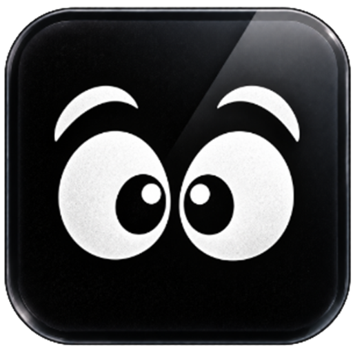
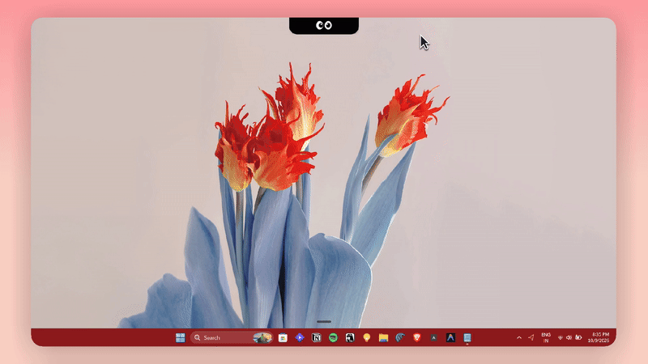
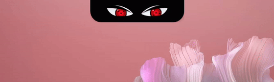

  

<h1 align="center">WeNotch</h1>

  <strong>A native desktop notch command center for Windows 11.</strong> 
  <em>Convenient, functional & aesthetic AF. Free forever with zero trackers.</em>

  
  
  
  
  

---

  

  <em>The notch docks quietly at the top of your screen, gazing at your cursor and unfurling into your full workspace on hover.</em>

---

### Hey there! 👋

Welcome to the official repository for **WeNotch**.

If you stumbled upon this repository while looking for the installer, you are in the right place at the right time. We are currently in our **private waitlist alpha**, putting the final touches on the first public build to make sure it is rock-solid on every monitor setup and DPI scale.

👉 **Join the Waitlist to get early download access**:  
### **[https://wenotch.vercel.app](https://wenotch.vercel.app)**

Drop your email on the site, and you will be in the very first batch to get the installer link when it goes live!

---

### What is WeNotch?

I love clean desktop aesthetics, but most Windows widgets feel clunky or eat up valuable screen real estate. I wanted something inspired by the MacBook notch that feels truly native, lightweight, and actually useful every single day.

WeNotch lives right at the very top of your primary monitor:

* ⏱️ **Focus Timer & Pomodoro**: Stay locked into your work sprint with a flick of your wrist.
* 📝 **Sprint Tasks & Scratchpad**: Capture fleeting thoughts and todo items without opening heavyweight apps.
* 📋 **Smart Clipboard**: Instantly recall your recent clips and image snippets.
* 👀 **Gazing Eye Companions**: Expressive desktop companions (including anime-inspired Sharingan and Rinnegan) that follow your mouse cursor smoothly across the desktop.
* 🎮 **Smart Auto-Retract**: Listens to OS window events and automatically shrinks to a 5px sliver during games or borderless fullscreen apps.
* 🛡️ **100% Local & Privacy First**: Runs natively on your machine with zero keystroke capture, zero screen logging, and no background telemetries.

  

---

### Download & Releases

All downloadable packages will be published directly on this repository under **[Releases](https://github.com/Satyabrat99/WeNotch/releases)**:

* 📦 **Setup Installer (`.exe`)**
* ⚡ **Winget Package (`winget install Satyabrat.WeNotch`)**
* 🗜️ **Portable Archive (`.zip`)**

Star this repository ⭐ or [join the waitlist](https://wenotch.vercel.app) to get notified the second the v1.0 release assets are published!

---

### Say Hello!

Built with love by **[@reddew777](https://x.com/reddew777)**.

If you have ideas for notch animations, eye designs, or desktop integrations, reach out to me on [X / Twitter](https://x.com/reddew777). I would love to hear what you think!
